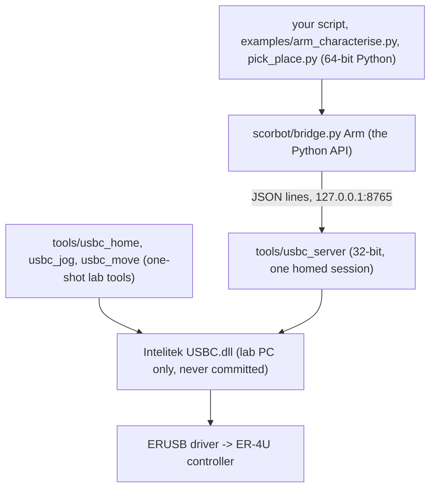

# CLAUDE.md

Python control for the Intelitek ScorBot ER-4U arm (original Controller-USB, USB `09F1:0007`) through Intelitek's own `USBC.dll`. The vendor Home ran on the real arm on 2026-10-20; everything else is unverified on hardware. **To move the arm: [docs/lab/RUN_THE_ARM.md](docs/lab/RUN_THE_ARM.md).** Every call, unit and error: [docs/API.md](docs/API.md). What works and how sure we are: [docs/STATUS.md](docs/STATUS.md).

Our own USB protocol (no DLL), the disassembly notes behind it and the original GPL OpenScorbot code are a separate line of work on the `stack2` branch; `main` is only the vendor-DLL path.

Each subdirectory has its own CLAUDE.md with module-level rules. Read it before editing there.

## Rules that matter

This is an engineering lab: if Sebastian asks for a run, run it. The red physical stop is the only emergency stop.

- Tests and CI never open USB or move the arm. The DLL is only ever driven through `tools/usbc_*`, which tests replace with a fake library.
- `Stop` in the server and `Arm.stop()` are not emergency stops; never call them that.
- Real and simulated data never share a session or comparison: `meta.json` says `real` only when the server's `ping` says `simulated: false`.
- Never commit Intelitek files: `USBC.dll`, its ini files, manuals (`references/`), captures. The repo is public.
- Vendor-DLL numbers are priors, not measurements; say "unverified" until a bench log backs a claim.

## Layers



## Repo map

| Path | Responsibility |
|---|---|
| `scorbot/bridge.py` | The Python API (`Arm`, `FakeArm`), standard library only |
| `scorbot/keys.py` | Keyboard commands (one per key press) shared by `record_episode.py` and `teleop.py` |
| `scorbot/camera/` | Frame sources (`FakeSource`, `OpenCVSource`) and JPEG encoding for `examples/record_episode.py`. OpenCV is the optional `camera` extra |
| `tools/usbc_server/` | The 32-bit server that holds the DLL session and serves `bridge.py` (`REQUIREMENTS.md`) |
| `tools/usbc_home/`, `usbc_jog/`, `usbc_move/` | One-shot vendor-DLL lab tools (32-bit, stdlib) |
| `tools/usbc_fake/` | The vendor DLL's Home against a fake controller on a named pipe (no USB, no arm) |
| `examples/` | `arm_characterise.py`, `pick_place.py`, `arm_latency.py`, `record_episode.py`, `teleop.py`, `sim_demo.py` (FakeArm only) |
| `plugins/lerobot_robot_scorbot_stack1/` | LeRobot-style adapter over `scorbot.bridge.Arm` with a safety layer and an episode writer; requirements in `docs/requirements/stack1-lerobot-adapter.md` |
| `scripts/` | `lab_check.py` (read-only checks before a lab run), `summarize_log.py` (a server log as a table), `setup_windows.ps1` |
| `tests/` | `unittest` suite, no hardware |
| `docs/` | `lab/RUN_THE_ARM.md`, `API.md`, `STATUS.md`, `PLAN.md`, `DESK_FINDINGS.md`, manual reference (`manual/`) |
| `models/` | OpenSCAD, STL, DXF parts from the original project (encoder, home jig) |
| `references/` | Local only: vendor manuals, never committed |

## Commands

**Verify before saying done** (about 15 s, no USB, never moves the arm): `ruff check . && python -m compileall -q scorbot scripts examples tests tools plugins && python -m pytest -q tests`. Read `LESSONS.md` before starting; add one dated line after a non-trivial task.

```powershell
python -m pip install -e ".[dev]"
uv sync --locked --extra dev      # lab PC: exact versions from uv.lock; after editing deps run `uv lock` (CI checks it)
python scripts\lab_check.py       # before a lab run: read-only checks
```

CI (`.github/workflows/tests.yml`): Windows and Ubuntu, Python 3.10 and 3.13, ruff, `uv.lock` check, compileall, pytest with coverage.

## Conventions

- Target is a Windows lab PC with only Python and VS Code. Keep lab-PC tools standard-library-first. Runtime dependency: `numpy` (camera sources only). Python >= 3.10.
- Docs show PowerShell with `.\.venv\Scripts\python.exe`. Open files with `encoding="utf-8"`.
- Evidence is append-only: logs and episodes are created with `open("x")` and never overwritten. Payloads are strict JSON (`allow_nan=False`).
- Claims about hardware must say "unverified" unless a bench log exists. Say so in code comments and docs too.
- Commits: imperative sentence-case subject, no prefix, body explains why. No AI attribution lines, in commits or pull requests (owner's rule; see `AGENTS.md`).
- Do not push or open PRs unless asked.

## Where to look

| Question | File |
|---|---|
| Run the arm (setup, commands, errors) | `docs/lab/RUN_THE_ARM.md` |
| Write a script against the arm | `docs/API.md` |
| Requirements and the test behind each | `REQUIREMENTS.md` |
| Where the project is going, and what we do not know yet | `docs/PLAN.md` |
| What the vendor DLL asks for (axes, directions, wrist units) | `docs/DESK_FINDINGS.md` |
| What the vendor DLL sends (from disassembly), own-protocol work | the `stack2` branch |
| Manual facts, LEDs | `docs/manual/HARDWARE_REFERENCE.md` |
