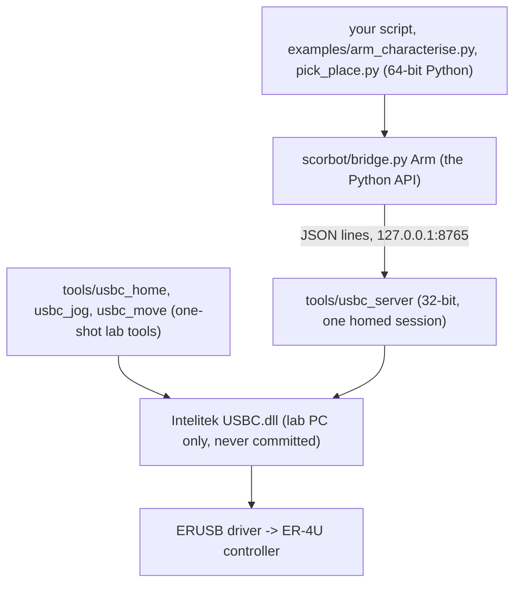
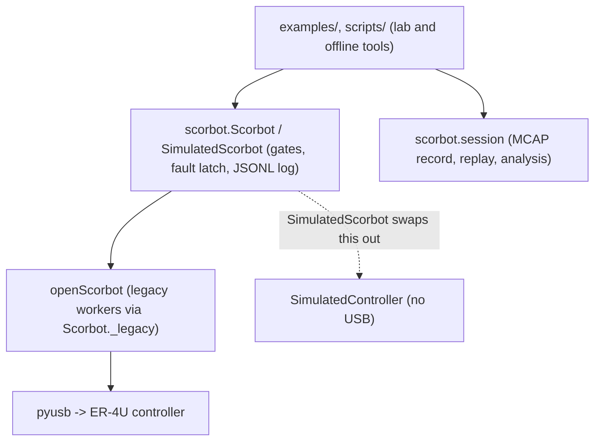

# CLAUDE.md

Python SDK, legacy USB protocol code, lab tools and offline research tools for the Intelitek ScorBot ER-4U arm (USB `09F1:0007`, original Controller-USB). The vendor Home through Intelitek's DLL ran on the real arm on 2026-10-20; everything else is unverified on hardware. **To move the arm: [docs/lab/RUN_THE_ARM.md](docs/lab/RUN_THE_ARM.md)** (the vendor-DLL tools in `tools/`). Deeper docs: [docs/design/ARCHITECTURE.md](docs/design/ARCHITECTURE.md), [docs/protocol/PROTOCOL.md](docs/protocol/PROTOCOL.md), [docs/manual/HARDWARE_REFERENCE.md](docs/manual/HARDWARE_REFERENCE.md). Old plans, specs, checklists and evidence are in `docs/archive/`.

Each subdirectory has its own CLAUDE.md with module-level rules. Read it before editing there.

## Rules that matter

This is an engineering lab: if Sebastian asks for a run, run it. The red physical stop is the only emergency stop.

- Tests and CI never open USB or move the arm (`conftest.py` makes real USB discovery raise under pytest).
- `openScorbot/` packet bytes and the `WRITE`/`READ` sleeps are load-bearing: change them only with a capture or the vendor disassembly (`docs/protocol/VENDOR_DLL_PROTOCOL.md`).
- `disable()` and `request_stop()` are not emergency stops; never call them that.
- Any fault latches the session; new failure paths call `Scorbot._latch_fault`.
- Encoder counts wrap at 65535: use `scorbot.calibration.signed_count_delta`, never raw subtraction.
- Real and simulated data never share a session or comparison.
- Never commit Intelitek files: `USBC.dll`, its ini files, manuals (`references/`), captures. The repo is public.
- Manual and vendor-DLL numbers are priors, not measurements; say "unverified" until a bench log backs a claim.

## Layers

Two stacks. **Stack 1 (vendor DLL) is how the arm moves today.** Stack 2 (our own USB protocol) is the long-term no-DLL goal and has never moved the arm; its one real home attempt failed (2026-10-06).

Stack 1:



Stack 2:



## Repo map

| Path | Responsibility |
|---|---|
| `scorbot/` | Public SDK: facade, state decode, calibration, the shared limits (`limits.py`), the source-based joint model (`source_model.py`), nominal manual values, the streaming follower (`streaming.py`), the inch home (`inch_home.py`), offline kinematics, the vendor's formulas read from the DLL (`vendor_model.py`, `vendor_profile.py`), the viewer's link chain `arm_chain.py`, simulator, preflight |
| `scorbot/session/` | MCAP session recorder, replay, analysis, CLI (`python -m scorbot.session`). Never imports USB |
| `scorbot/camera/` | Webcam capture: per-camera stream files next to a session, recorder threads with a bounded stop, `python -m scorbot.camera check`. OpenCV optional (`[camera]`). Never imports USB |
| `scorbot/transport/` | Pure packet codec (`codec.py`), proven byte-identical to the legacy code by golden tests (`tests/test_transport_codec.py`). Not wired into `Scorbot`. Phase A of the USB upgrade. Also `device_file.py` (Intelitek-driver link, used by `Scorbot(transport=...)`) and `probe.py` |
| `openScorbot/` | Original GPL OpenScorbot protocol code plus `motion_profile.py`; frozen legacy backend, PyQt GUI kept as reference |
| `examples/` | Supervised bench procedures (`--simulate` capable), synthetic session, offline preview and kinematics check |
| `scripts/` | Offline analysis (fit, lab log to calibration CSV, review, live view, USB trace), kit and Windows setup |
| `tests/` | `unittest` suite, no hardware: the lab-visit gate |
| `tests_extra/` | Tests for code off the first-trial path (streaming, gripper, cameras, viewers, offline tools). Same rules, run by CI, not part of the gate |
| `docs/` | `lab/RUN_THE_ARM.md` (run the arm), protocol and manual reference, architecture. `archive/` holds old specs, plans, checklists and evidence |
| `models/er4u_meshes/` | Optional community link meshes for the 3D view. Only the README is tracked; never commit the STL files (licence unclear) |
| `tools/foxglove/` | Foxglove layouts for recorded sessions |
| `tools/usbc_home/`, `usbc_jog/`, `usbc_move/`, `usbc_server/` | The vendor-DLL lab tools (32-bit, stdlib). `usbc_server` keeps one homed session and serves the Python API `scorbot/bridge.py` over 127.0.0.1 (`docs/requirements/arm-api.md`) |
| `tools/usbc_fake/` | The vendor DLL's Home against a fake controller on a named pipe (no USB, no arm), with switch widths you choose; guards against a real device |
| `tools/usbc_analysis/` | Ghidra export script and query tool for static analysis of the vendor `USBC.dll`. Never commit the DLL or its decompiled output |
| `models/` | OpenSCAD, STL, DXF parts from the original project (encoder, home jig) |
| `references/` | Local only: vendor manuals, never committed (`references/*.pdf` is git-ignored) |

## Commands

**Verify before saying done** (about 1 min with `-n 2`, no USB, never moves the arm): `ruff check . && python -m compileall -q scorbot openScorbot scripts examples tests && python -m pytest -n 2 -q tests`. Last run 2026-10-22: 1011 passed in 54 s. Read `LESSONS.md` before starting; add one dated line after a non-trivial task.

```powershell
python -m pip install -e ".[dev]"              # add ,kinematics for the Robotics Toolbox cross-check; windows extra adds libusb-package; gui adds PyQt5
uv sync --locked --extra windows --extra test --extra planning  # lab PC: Python 3.13 + exact versions from uv.lock (planning = Ruckig, needed by start_stream); after editing deps run `uv lock` (CI checks it)
python -m compileall -q scorbot openScorbot scripts examples tests
python -m pytest -n 2 tests                    # the lab-visit gate: about 645 tests, under 2 min, no expected failures
python -m pytest -n 2 tests tests_extra        # everything: about 930 tests (tests_extra = code off the first-trial path; CI runs both)
python -m unittest discover -s tests -v        # the gate with plain unittest
python examples/make_synthetic_session.py --root <tmpdir>   # CI smoke test
ruff check .                                   # CI rules incl. bugbear (openScorbot/ excluded); `pre-commit install` runs it on every commit
```

Simulated rehearsal (no USB; every output says SIMULATED). Use a `rehearsal\` folder, never `logs\`:

```powershell
python -m scorbot.lab --simulate --profile rehearsal\lab.json --logs rehearsal   # guided session rehearsal
python examples\record_raw_state.py --output rehearsal\idle-01.jsonl --robot-id lab-er4u-1 --arm-label x --controller-label x --driver none --operator XX --pose-note rehearsal --seconds 2 --simulate --acknowledge-connect-handshake
python examples\bench_joint.py --output rehearsal\base-01.jsonl --robot-id lab-er4u-1 --arm-label x --controller-label x --driver none --operator XX --start-pose-note rehearsal --joint base --delta 1 --simulate --acknowledge-supervised-motion
python scripts\review_lab_logs.py --idle rehearsal\idle-01.jsonl --bench rehearsal\base-01.jsonl
python -m scorbot.session list|export|compare <paths>
```

CI (`.github/workflows/tests.yml`): Windows and Ubuntu, Python 3.10 and 3.13, compileall, unittest, synthetic session.

## Conventions

- Target is a Windows lab PC with only Python and VS Code. Keep lab-PC tools standard-library-first (`scripts/usb_trace.py`, `watch_lab_log.py` and `scorbot/nominal.py` are stdlib only). Runtime deps: `mcap`, `numpy`, `pyusb`. Python >= 3.10.
- Docs show PowerShell with `.\.venv\Scripts\python.exe`. Open files with `encoding="utf-8"`; console output on Windows may be cp1252.
- Primary evidence is append-only JSONL (`open("x")`, never overwrite) plus an MCAP session (`scorbot/session`). MCAP is best-effort secondary; JSONL is written first. Payloads are strict JSON (`allow_nan=False`).
- Encoder counts are unsigned 16-bit with a 65535 (one's complement) wrap. Take differences with `scorbot.calibration.signed_count_delta`, never subtract raw or signed counts.
- Claims about hardware must say "unverified" unless a bench trace exists. Say so in code comments and docs too.
- Tests use `unittest`. Optional deps skip (`hypothesis`, `roboticstoolbox`, `usb`).
- Commits: imperative sentence-case subject, no prefix, body explains why. No AI attribution lines, in commits or pull requests (owner's rule; see `AGENTS.md`).
- Do not push or open PRs unless asked.

## Where to look

| Question | File |
|---|---|
| Run the arm (setup, commands, errors) | `docs/lab/RUN_THE_ARM.md` |
| Why is the design what it is | `docs/design/ARCHITECTURE.md` |
| Packet layout, command codes | `docs/protocol/PROTOCOL.md`, `openScorbot/libhex.py`, `scorbot/state.py` |
| What the vendor DLL sends (from disassembly) | `docs/protocol/VENDOR_DLL_PROTOCOL.md`; method in `tools/usbc_analysis/README.md` |
| How the vendor homes, jogs and couples joints | `docs/protocol/VENDOR_HOMING_TRACE.md`, `VENDOR_COUPLING_TRACE.md`, `VENDOR_MANUAL_MOVE_TRACE.md` |
| Steps to move the arm and how sure we are of each | `docs/protocol/BRING_UP_SEQUENCE.md` |
| Every arm number and its source | `docs/manual/ER4U_MODEL.md` (code: `scorbot/source_model.py`) |
| Manual facts, LEDs | `docs/manual/HARDWARE_REFERENCE.md` |
| USBPcap capture, joint-angle measurement, Windows driver | `docs/lab/USB_CAPTURE.md`, `docs/lab/PHYSICAL_CALIBRATION.md`, `docs/lab/WINDOWS_BENCH_RUN.md` |
| Old plans, checklists, runbooks, evidence | `docs/archive/` |

## Before you change X, read Y

| Change | Read first |
|---|---|
| `scorbot/robot.py` and `scorbot/homing.py` gates, faults, threading, homing | `tests/test_python_api.py`, `tests/test_simulated.py`, `docs/design/ARCHITECTURE.md` sections 8, 11 |
| `openScorbot/*` | `openScorbot/CLAUDE.md`, `docs/lab/USB_CAPTURE.md` |
| Session schema or topics | `scorbot/session/schemas.py`, `docs/archive/design/EXPERIMENT_RECORDING.md`; bump `SCHEMA_VERSION` only with a reader migration |
| Calibration fields | `scorbot/calibration.py`, `scripts/fit_calibration.py`, `docs/lab/PHYSICAL_CALIBRATION.md` (loader and fitter must agree) |
| Log event names | `scripts/watch_lab_log.py:ALARM_EVENTS`, `scripts/review_lab_logs.py` (both parse them) |
