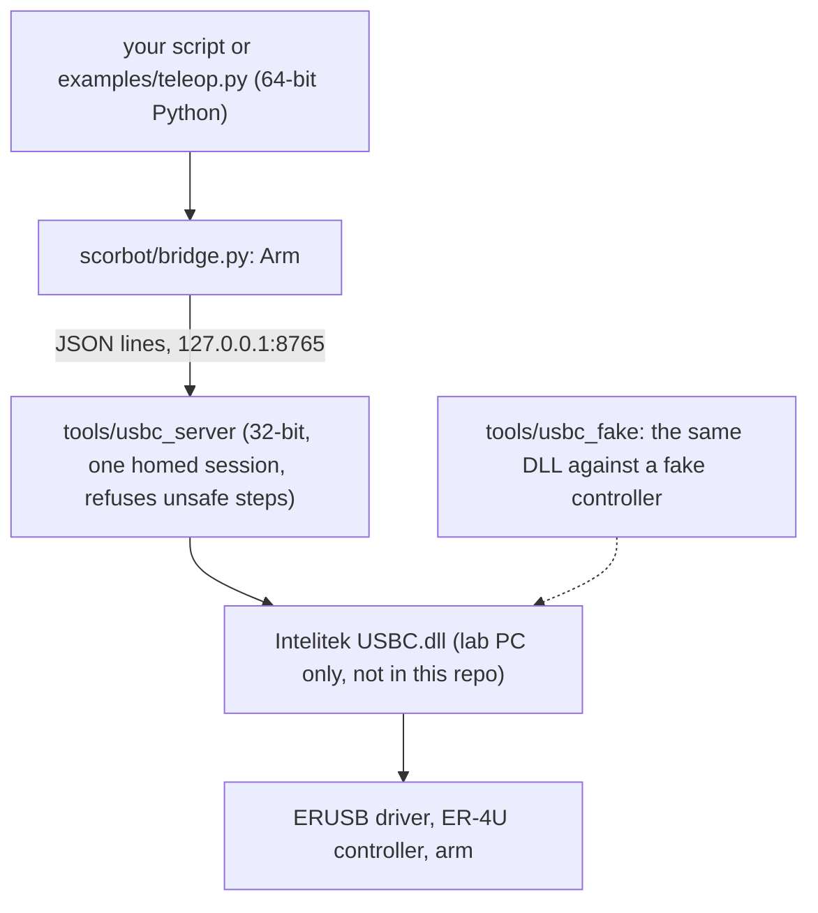

# ScorBot ER-4U Python control

Python control for the Intelitek ScorBot ER-4U arm (original Controller-USB). A script talks to a small local server that holds one homed session with Intelitek's own `USBC.dll`.

```python
from scorbot.bridge import Arm          # FakeArm has the same calls and needs no arm

with Arm() as arm:                     # needs the arm server (below); FakeArm needs nothing
    arm.move_by(dz=20)                  # mm
    arm.gripper(open=False)
    print(arm.where())
```

**WARNING:** the red physical stop is the only emergency stop. Nothing in this repository replaces it.

## Start here

| You want to | Go to | Needs the arm |
|---|---|---|
| Try the API on your laptop | [Try it with no hardware](#try-it-with-no-hardware) below | no |
| Move the real arm for the first time | [docs/lab/RUN_THE_ARM.md](docs/lab/RUN_THE_ARM.md), then the checklist in [docs/lab/LAB_RUN_SHEET.md](docs/lab/LAB_RUN_SHEET.md) | yes |
| Write a script | [docs/API.md](docs/API.md): every call, unit and error | no |
| Know what works and how sure we are | [docs/STATUS.md](docs/STATUS.md) | no |
| Check the requirements and their tests | [docs/requirements/arm-api.md](docs/requirements/arm-api.md) | no |
| See what the vendor DLL does without the arm | [docs/DESK_FINDINGS.md](docs/DESK_FINDINGS.md) | no |
| Look up hardware facts (LEDs, limits, homing) | [docs/manual/HARDWARE_REFERENCE.md](docs/manual/HARDWARE_REFERENCE.md) | no |
| See what changed | [CHANGELOG.md](CHANGELOG.md) | no |

## Try it with no hardware

```powershell
python -m venv .venv
.\.venv\Scripts\python.exe -m pip install -e ".[dev]"
.\.venv\Scripts\python.exe -c "from scorbot.bridge import FakeArm; a = FakeArm(); a.move_by(dz=20); print(a.where())"
.\.venv\Scripts\python.exe -m pytest -n 2 tests          # about 15 seconds; never opens USB or moves the arm
```

Expected: the one-liner prints a `Position` with `z=220.0` (the fake arm starts at `z=200.0`), and the tests pass.

## Run the real arm

Lab PC only. It needs Intelitek's `USBC.dll` (not in this repository) and a 32-bit Python for the server. Follow [docs/lab/RUN_THE_ARM.md](docs/lab/RUN_THE_ARM.md): setup, start the server, first moves, troubleshooting.

## How it fits together



The server enforces the limits: a step cap of 50 mm per axis, a measured working box for absolute moves, and a stop when the client disconnects. The DLL is 32-bit, which is why it sits behind its own small server.

## What works, and how sure we are

Each capability has an evidence level from E0 (idea) to E5 (ran on the arm repeatedly); the full table is in [docs/STATUS.md](docs/STATUS.md).

| Capability | Status |
|---|---|
| Vendor Home through the DLL | Ran on the arm, 2026-10-20, once (E4) |
| Arm server and Python API (`move_by`, `move_to`, gripper, speed) | Tested, and run against the DLL on a fake controller (E3). Not yet run on the arm |
| Physical mm scale of moves | Not measured. `examples/arm_characterise.py` measures it |
| Pick and place, keyboard control, wrist steps, run log | Built and tested (E2). Not yet run on the arm |
| Own USB protocol without the DLL | Separate research line on the `stack2` branch. Never moved the arm |

A hardware claim stays "unverified" until a bench log backs it.

## Layout

| Path | What it is |
|---|---|
| [`scorbot/`](scorbot/README.md) | The Python API (`Arm`, `FakeArm`), standard library only, and the camera sources |
| `tools/usbc_server/` | The 32-bit server that holds the DLL session |
| `tools/usbc_home`, `usbc_jog`, `usbc_move` | One-shot lab tools through the DLL |
| [`tools/usbc_fake/`](tools/usbc_fake/README.md) | The DLL against a fake controller (no arm) |
| [`examples/`](examples/README.md) | Keyboard control, characterisation, pick and place, latency, episode recorder |
| [`plugins/`](plugins/lerobot_robot_scorbot_stack1/README.md) | A LeRobot-style adapter with a safety layer |
| [`scripts/`](scripts/README.md) | Preflight check, log summary, setup |
| [`tests/`](tests/README.md) | `unittest` suite, no hardware |
| `docs/` | Guides, reference, status and requirements (table above) |
| `models/` | OpenSCAD, STL and DXF parts from the original project |

## Rules

- Never commit Intelitek files: `USBC.dll`, its ini files, manuals, captures. The repository is public.
- Tests and CI never open USB or move the arm.
- The lab PC installs exact versions with `uv sync --locked --extra dev`. After you edit dependencies in `pyproject.toml`, run `uv lock`; CI fails if `uv.lock` is out of date.
- Before you submit a change, run `ruff check . && python -m compileall -q scorbot scripts examples tests tools plugins && python -m pytest -q tests`. `python scripts/check_docs.py` checks the documentation.

Documentation follows [docs/STYLE.md](docs/STYLE.md).

## Original project

OpenScorbot was developed by José Luis Pérez Pérez and Yolanda M. Gimeno Rodríguez at the University of La Laguna ([original repository](https://github.com/tidus747/openScorbot)). This repository started from that project and keeps the GPL-3.0 license; the original code is on the `stack2` branch.
