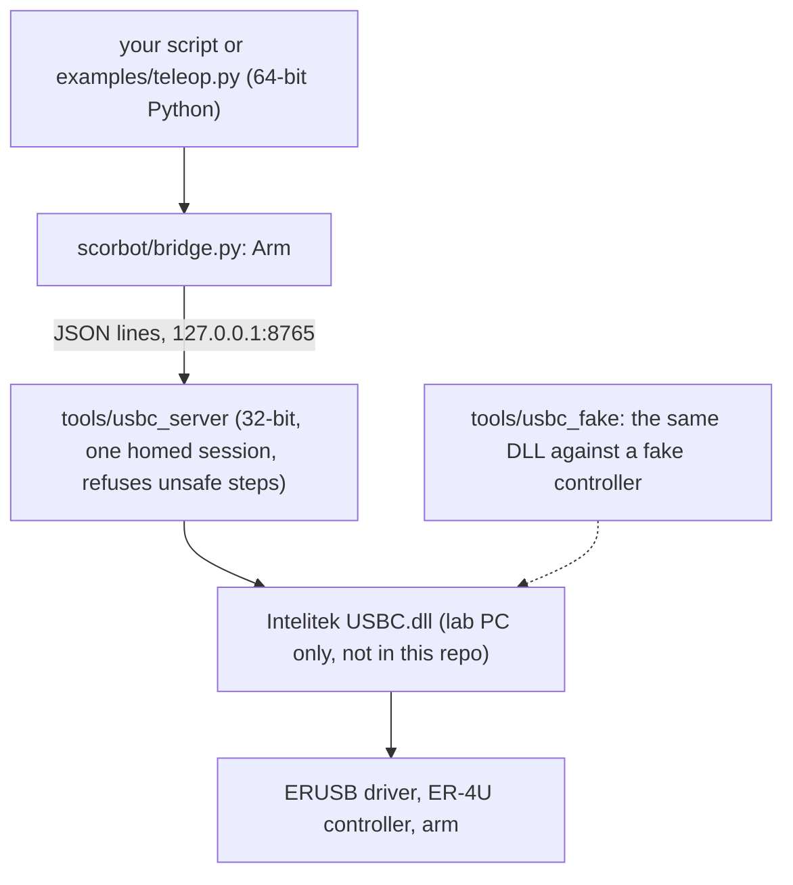

# ScorBot ER-4U Python control

Python control for the Intelitek ScorBot ER-4U arm (original Controller-USB). A script talks to a small local server that holds one homed session with Intelitek's own `USBC.dll`:

```python
from scorbot.bridge import Arm          # FakeArm has the same calls and needs no arm

with Arm() as arm:
    arm.move_by(dz=20)                  # mm
    arm.gripper(open=False)
    print(arm.where())
```

**The red physical stop is the only emergency stop.** Nothing in this repo replaces it.



## For a reviewer

Start with [docs/STATUS.md](docs/STATUS.md): every capability has an evidence level from E0 (idea) to E5 (ran on the arm repeatedly). Today only the vendor Home is E4. Everything else is built and tested at the desk, and the first lab run is the next step.

| To check | Look at |
|---|---|
| What the code promises, and the test behind each promise | [REQUIREMENTS.md](REQUIREMENTS.md) (baseline approved 2026-10-26) |
| The safety limits (step caps, box, stop on disconnect) | `tools/usbc_server/usbc_server.py`, `tests/test_usbc_server.py` |
| What was learned from the vendor DLL without the arm | [docs/DESK_FINDINGS.md](docs/DESK_FINDINGS.md) |
| The order of the lab day | [docs/lab/LAB_RUN_SHEET.md](docs/lab/LAB_RUN_SHEET.md) |

`CLAUDE.md`, `AGENTS.md` and `LESSONS.md` are working notes for the coding agents used on this repo; the project does not depend on them.

## Try it with no hardware

```powershell
python -m pip install -e ".[dev]"
python -c "from scorbot.bridge import FakeArm; a = FakeArm(); a.move_by(dz=20); print(a.where())"
python -m pytest -n 2 tests          # about 15 seconds, never opens USB or moves the arm
```

## Run the real arm

Lab PC only. It needs Intelitek's `USBC.dll` (not in this repo) and a 32-bit Python for the server. One page covers setup, commands and errors: **[docs/lab/RUN_THE_ARM.md](docs/lab/RUN_THE_ARM.md)**. Every call, unit and error: **[docs/API.md](docs/API.md)**.

## What works, and how sure we are

Full table with evidence levels: [docs/STATUS.md](docs/STATUS.md).

| | Status |
|---|---|
| Vendor Home through the DLL | Ran on the real arm, 2026-10-20 (once) |
| Arm server and Python API (`move_by`, `move_to`, gripper, speed) | Tested, and run against the DLL on a fake controller. Not yet run on the arm |
| Physical mm scale of moves | Unmeasured. `examples/arm_characterise.py` measures it |
| Pick and place (`examples/pick_place.py`) | Written, not yet run on the arm |
| Keyboard control and wrist steps (`examples/teleop.py`, `wrist_by`) | Tested, and the wrist run against the DLL on a fake controller. Not yet run on the arm; the wrist unit is unverified |
| Own USB protocol without the DLL | Separate research line on the `stack2` branch. Never moved the arm |

Hardware claims are "unverified" until a bench log backs them.

## Layout

| Path | What it is |
|---|---|
| `scorbot/bridge.py` | The Python API (`Arm`, `FakeArm`), standard library only |
| `scorbot/keys.py` | Keyboard commands shared by `record_episode.py` and `teleop.py` |
| `tools/usbc_server/` | The 32-bit server that holds the DLL session |
| `tools/usbc_home`, `usbc_jog`, `usbc_move` | One-shot lab tools through the DLL |
| `tools/usbc_fake/` | The DLL against a fake controller (no arm) |
| `scorbot/camera/` | Frame sources and JPEG encoding for the episode recorder |
| `examples/` | `arm_characterise.py`, `pick_place.py`, `arm_latency.py`, `record_episode.py`, `teleop.py` |
| `scripts/lab_check.py` | Read-only checks before a lab run |
| `docs/` | Index in [docs/README.md](docs/README.md); the plan is [docs/PLAN.md](docs/PLAN.md) |
| `tests/` | `unittest` suite, no hardware |

## Rules

- Never commit Intelitek files: `USBC.dll`, its ini files, manuals, captures. The repo is public.
- Tests and CI never open USB or move the arm.
- Contributor and agent rules: [CLAUDE.md](CLAUDE.md).

## Original project

OpenScorbot was developed by José Luis Pérez Pérez and Yolanda M. Gimeno Rodríguez at the University of La Laguna ([original repo](https://github.com/tidus747/openScorbot)). This repository started from that project and retains the GPL-3.0 license; the original code is on the `stack2` branch.
