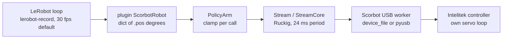

# The LeRobot chain on Stack 2

**As of 2026-11-02, branch `stack2`.** A desk review of LeRobot -> plugin -> `PolicyArm` -> stream -> USB -> Intelitek controller, read from the code and from LeRobot 0.6.1's source in its own venv. Nothing in this chain has run on the arm; every arm number below is unverified until a dated bench log backs it. Status levels are the E-scale in [`STATUS.md`](STATUS.md).

## 1. Each link

| Link | One job | Interface | Plug-in point | Rate and latency (desk numbers) | Proof today |
|---|---|---|---|---|---|
| LeRobot loop (`lerobot_record.py`) | Every frame: `get_observation()`, teleop or policy action, `send_action()`, write the frame, sleep to the frame period | `Robot` ABC (`lerobot/robots/robot.py`): features, connect, observe, act, disconnect | Official | `--dataset.fps` (default 30, so 33 ms a frame); logs a warning and runs slow when a frame overruns, never skips the arm call | lerobot 0.6.1 itself |
| Plugin (`plugins/lerobot_robot_scorbot`) | Map `base.pos`, `shoulder.pos`, `elbow.pos` to `PolicyArm`; refuse the real arm | `RobotConfig.register_subclass("scorbot")`, package named `lerobot_robot_*` so `register_third_party_plugins` imports it | Official: the third-party route `register_third_party_plugins` scans for; `so101_follower` is built in but uses the same `Robot` ABC and feature dict | Adds nothing measurable; one `observe()` per `get_observation`, one `act()` per `send_action` | Sim, 2026-11-01 (`examples/lerobot_sim_check.py`: record, reload, replay) |
| `PolicyArm` (`scorbot/policy_arm.py`) | The one safety clamp: step per call, travel cap, lead margin; homes with the vendor Home (`vendor_home`) on connect, after the operator's three confirmations | `connect / observe / act / close`, absolute degrees from home | Ours (simplest: no LeRobot types) | Each `observe()` waits for a reply newer than the last one read (`packet.snapshot(after_index=...)`); `get_observation()` usually finds one already there after LeRobot's frame sleep. Since #110, `act()` clamps against the reading of the `observe()` just before it (used once) and reads a fresh one only when nothing was observed since the last `act()`: one controller wait per frame, not two (the second used to cost up to one 24 ms stream period). The clamp's reading is the one the policy saw, so it is older by the policy's inference time; the stream's own lead limit still checks every fresh reply. Desk proof 2026-11-03: unit tests with a 24 ms simulated reply delay (`tests_extra/test_policy_arm.py`). Unverified on the arm | Unit tests (file last changed 2026-11-03, #110; speed mode #77 merged 2026-11-02); sim 2026-11-01 |
| Stream (`scorbot/streaming.py`, `stream_control.py`) | Smooth the latest target into one setpoint per period, jerk-limited (Ruckig); hold after 0.5 s with no target; fault on lead over the limit, controller error word, travel cap or pose limit | `start_stream(...)` -> `set_target(counts)`; any thread | Ours | Period 24 ms (vendor `PCPeriod x USBCPeriod`, a prior); a new target is used at the next period, so 0 to 24 ms plus Ruckig's ramp | Unit tests (last changed 2026-11-01); sim 2026-11-01; `examples/policy_arm_speed_sim.py` |
| USB worker and transport (`scorbot/robot.py`, `scorbot/transport/`) | One message out, one reply in, per period; legacy order 21 sends three absolute setpoints | `device_file` (Intelitek's ERUSB driver) or `pyusb` (WinUSB) | Ours | Reply gap expected 14 to 25 ms (lab checklist step P); a silent controller costs about 5 s per read on ERUSB (ledger PL31) | Connect and idle read: E4 (2026-09-29); legacy home failed after 4.2 s (2026-10-06); vendor-home port E3 on the fake |
| Intelitek controller | Closes the position loop on each motor | Setpoints in encoder counts | Vendor | Unknown on this arm | Stack 1 vendor Home, 2026-10-20 (E4, through the DLL, not this chain) |

**Compared with `so101_follower`:** its `send_action` writes `Goal_Position` straight to the Feetech servos and lets each servo's own PID smooth; an optional `max_relative_target` clamps each goal against a fresh `Present_Position` read. Ours does the same three things in different places: `PolicyArm.clamp` is our `max_relative_target`, and Ruckig in the stream plays the servo's role because the controller only takes setpoints. The SO-101 reads its bus once per observation and once more only when the clamp is on; we read once per frame (#110): `act()` clamps against the reading `get_observation()` just made.

## 2. Action format, smoothing, speed ceiling

- **Action:** a dict of absolute joint targets, `base.pos`, `shoulder.pos`, `elbow.pos`, in degrees from this session's home (vendor counts-per-degree prior, uncalibrated). No gripper, no wrist pitch or roll. `so101_follower` uses the same shape plus `wrist_flex`, `wrist_roll` and `gripper.pos` (0 to 100).
- **What LeRobot stores:** `lerobot-record` writes the action it *asked for*, not what `send_action` returned (its own TODO at the `send_action` call). Our teleoperators pre-clamp with the same `clamp`, so their stored actions match; a policy's stored or evaluated action can be ahead of what the arm got.
- **Smoothing happens twice:** `PolicyArm.clamp` limits each call's step (a hard per-frame cut), then `StreamCore` runs Ruckig every 24 ms with velocity `speed_pct` x MaxSpeed, acceleration and jerk from the vendor's jog profile. Action chunks from a policy arrive as one target per frame; nothing interpolates between frames except Ruckig.
- **Default reach:** `travel_cap_deg` is 2 degrees from home. Any real demo needs it raised; the speed below only matters once it is.

Speed ceiling, degrees per second, with the vendor priors (MaxSpeed 6500 counts/s; base 141.9 and shoulder or elbow 113.5 counts per degree from `scorbot/nominal.py`). The arm gets the lower of PolicyArm's step and the stream's velocity limit. All desk arithmetic, unverified:

| Step mode | `speed_pct` | 10 fps | 30 fps |
|---|---|---|---|
| fixed (default): 0.5 degree per call | 25 | 5 | base 11.5, shoulder and elbow 14.3 (stream limit; the step alone would allow 15) |
| fixed | 100 | 5 | 15 |
| speed (#77): MaxSpeed x pct x time since the last call, at most 1.5 degrees per call | 25 | base 11.5, shoulder and elbow 14.3 | same |
| speed | 100 | 15 (1.5 degree per call cap) | base 45, shoulder and elbow 45 (cap; MaxSpeed alone would allow 45.8 and 57.3) |

Two more limits apply on the arm: the target never leads the measured joint by more than 1.5 degrees (so a lagging arm slows the command), and below 2 calls a second the stream holds. If the reply wait in `act()` (section 1) plus cameras push a frame past 33 ms, LeRobot runs slower than 30 fps; the fixed step then loses speed with every slow frame, while the speed mode's step grows with the time since the last call, so its speed survives a slow loop.

## 3. The gripper gap

`PolicyArm` drives `limits.ARM_MOTORS` only, so the plugin has no `gripper.pos`. Three things stand in the way:

1. `Scorbot.move_gripper` is refused while a stream runs (`_refuse_if_streaming`), and the stream carries arm slots only.
2. Fixed (#96): the gripper needs a **vendor** Home in the session, and `PolicyArm.connect` used to run the **legacy** `home(start_position_confirmed=True)` (the routine that failed on the arm on 2026-10-06, and one that clears `_gripper_homed`). It now runs `vendor_home` with the operator's three confirmations (`operator_at_stop`, `jaws_empty`, `wrist_clear`, each default false in the plugin config), which leaves `_gripper_homed` set. On the simulator only; unverified on the arm.
3. The vendor gripper move is a blocking S-curve to fully open (5000 counts) or closed (0), no force limit, of unknown duration on this arm.

Simplest close (pick): a binary `gripper.pos` (0 closed, 100 open, threshold at 50, like the SO-101's 0 to 100 range). On a change, `PolicyArm` closes the stream to rest, calls `open_gripper` or `close_gripper`, and starts a new stream. Cost: the LeRobot loop stalls for the gripper move plus a stream restart, which `lerobot-record` logs as a slow frame. The continuous alternative (a gripper slot inside the stream) needs the gripper's setpoint message inside order 21, which no capture shows; not worth it before the arm has streamed at all.

## 4. Stack 1 vs Stack 2 behind LeRobot

They are not behind the same plugin today: Stack 1 has its own, `lerobot_robot_scorbot_stack1` on `main` (relative xyz in mm plus gripper, over `scorbot.bridge.Arm`). Datasets from the two are not interchangeable.

| | Stack 1 plugin (vendor DLL) | Stack 2 plugin (this chain) |
|---|---|---|
| Effort to a first real LeRobot run | Low: built, has `allow_real`, gripper and cameras included | Medium: lift the real-arm refusal behind a stop key, raise the travel cap, add the gripper |
| Risk | Lower: the vendor plans each move inside a measured box; but each frame is one blocking point move (no new target mid-move), so motion is stop-and-go | Higher: streaming, its period and its stop sequence have never run on the arm; first trials are one motor, about a degree |
| Proof | Vendor Home E4 (2026-10-20); bridge E3 (desk run on the lab DLL, fake controller); plugin sim and FakeArm with lerobot 0.6.1 (2026-10-28) | Plugin sim with lerobot 0.6.1 (2026-11-01, E2); USB connect E4, legacy home failed (2026-10-06), vendor-home port E3 |
| Fits | Chunked "go there" actions, slow demos | Continuous joint control at a steady rate, which is what VLA policies expect |

**Pick for the first real-arm LeRobot runs: Stack 1, pending the lab.** It is the only path that has moved this arm, and its plugin needs no code change to try. **Pick for the long term: Stack 2, pending the lab.** It is the one that can follow a policy's targets continuously without the vendor DLL; it becomes the first choice once step G passes and one supervised `bench_stream.py` trial follows within its lead limit.

## 5. Measurements the lab should record

Each one fills a number this page only has as a prior. Order follows the lab checklist; none adds motion beyond steps already planned there except where marked.

| Measurement | How | Gives it |
|---|---|---|
| Streaming period (sets the LeRobot frame budget) | Step P gives the idle reply gap (median and worst); the period that counts is the one while streaming, from the `bench_stream.py` trial below. Up to one period per frame is the plugin's wait | The probe's timing line; the `host_monotonic_ns` of the step records in the `bench_stream.py` log |
| Counts per degree and direction, per joint | After G: a 1 degree jog per joint, read the angle with a phone level | `examples/bench_joint.py`, then `scripts/lab_summary.py --phone base=<deg>` |
| Stream lag (encoder vs command) | After G, operator go: one supervised `bench_stream.py` trial per motor, 1 degree out and back, at speed 25 (moves) | `scripts/follow_report.py` (#80) on the controller log: worst lag vs the lead limit, peak speed vs MaxSpeed, overshoot, settle time |
| Replay repeatability (proxy) | `lerobot-replay` cannot run on the arm while the plugin refuses it, and `scorbot/session` replay is offline only. Proxy: run the same `bench_stream.py` trial three times; compare the settled counts at the end of each leg, and the tape marks from step H (moves) | The `measured` counts in each log's last step records; `scripts/follow_report.py` gives each settle time |
| Gripper move time and travel | Step G's three gripper drives: time from first setpoint to stall, and counts travelled | The G log (`bring_up.py --logs`); sets how long a gripper action stalls the LeRobot loop |
| Stack 1 action rate (the first-run pick) | After H: `examples/arm_latency.py --speed 20`, then 50 (moves, up and down in z) | Its own `logs/arm-latency-*.jsonl`: calls per second for `where`, `move_by` and the gripper |
