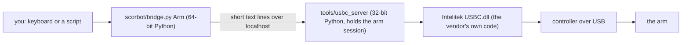
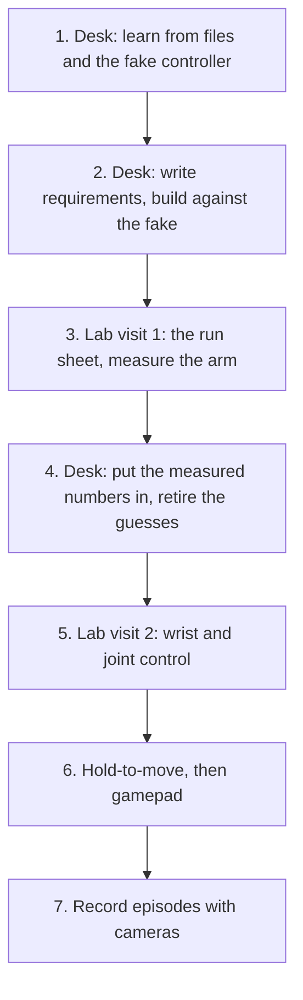

# Plan: from first motion to full control of the arm

Written 2026-10-25. Plain version of where the project is, what we do next, and how we reach the goal. Evidence levels (E0 to E5) are defined in [STATUS.md](STATUS.md); nothing below has run on the arm except the vendor Home.

## The goal

Drive **all** of the ScorBot ER-4U from a PC, safely: the x, y, z position of the tool, the wrist pitch and roll, each joint on its own, and the gripper. Control it from Python, from the keyboard, and later by holding a key. Then record what the arm does so a robot can learn from it.

## How the system works

Why two Pythons: the vendor DLL is 32-bit, so one small 32-bit server owns it and everything else talks to the server. The server enforces the limits (the box, the 50 mm step cap). The red button on the arm is the only emergency stop.

## What is done

- The server and the Python API (`Arm`, `FakeArm`) for position moves, speed and gripper.
- Vendor Home ran on the real arm (2026-10-20). Nothing else has.
- A desk rehearsal of the whole flow against the real DLL and a fake controller (`tools/usbc_fake`).
- Scripts: characterise (measure the arm), pick and place, latency, record episode, keyboard control (`examples/teleop.py`), and relative wrist steps (`wrist_by`, `--wrist-step`).
- Desk findings from the vendor DLL on the fake controller ([DESK_FINDINGS.md](DESK_FINDINGS.md)) and the requirements rows W01 to W03 ([../REQUIREMENTS.md](../REQUIREMENTS.md)).
- A lab run sheet ([lab/LAB_RUN_SHEET.md](lab/LAB_RUN_SHEET.md)) and a read-only preflight (`scripts/lab_check.py`).

## What we do not know yet

| Unknown | Blocks | How we find out |
|---|---|---|
| Which DLL axis number is which joint, and which direction is plus | joint jog | ask the DLL through the fake controller; confirm at the lab |
| How far one pitch or roll unit turns the wrist | wrist keys | same; confirm at the lab |
| Whether `move_by` keeps the wrist still | wrist keys | lab |
| The box (where the arm may go) and the mm scale | `move_to`, wrist keys | `arm_characterise.py` at the lab |
| Real speed (calls per second) | hold-to-move | `arm_latency.py` at the lab |
| How far the arm coasts after a stop | hold-to-move | lab, slow and short |
| How the controller reacts if USB drops | hold-to-move safety | last, a careful bench test |

Step 1 is done: [DESK_FINDINGS.md](DESK_FINDINGS.md) lists what the DLL itself says about axes, directions, wrist units and the wrist coupling. The vendor's own files already give per-axis limits, jog directions and the arm's link lengths (read-only, local, never committed). They are priors, not measurements.

## The path

**Where we are:** step 1 is done, and the wrist part of step 2 is done and merged. Joint jog and hold-to-move wait for the lab. Next is step 3.

1. **Learn at the desk.** Ask the vendor DLL what it sends the controller for each move (through the fake): axis order, directions, counts per mm and per degree, how pitch and roll map to the two wrist motors. Read the disassembly notes on the `stack2` branch and the manuals for the rest.
2. **Requirements, then build.** A short numbered list (the `requirements` skill), each line with a check. Then build wrist keys, joint jog and hold-to-move against the fake DLL. Unknown numbers live in one settings spot with tiny, slow defaults. Tests cover only what can hurt the arm: step caps, stop on release, cleanup after an error or Ctrl+C, refusals outside the box.
3. **Lab visit 1.** Follow the run sheet: preflight, Home, `where`, one small move, gripper, latency, characterise, teach four points, pick and place. Record every number in `docs/STATUS.md`.
4. **Fold the numbers in.** Replace each guess with a measured value. A claim moves up an evidence level only when a log backs it.
5. **Lab visit 2.** Try the wrist keys and joint jog at tiny steps and 5 percent speed, then check the signs and units against the desk table.
6. **Hold-to-move.** Short capped bursts sent while a key is held, stop when presses stop. Needs the latency and coast numbers. Gamepad later.
7. **Record episodes.** Cameras plus arm state plus your commands, for learning. The recorder exists; it has not run with real cameras.

## Rules that do not change

- No code moves the real arm unless Sebastian is there, a hand is near the red stop, and he says go.
- Every new motion feature starts slow: small steps, low speed, a hard cap, and a refusal on anything unexpected.
- Anything not measured on the arm is written "unverified".
- Branches are reviewed by Codex before merge; nothing merges to `main` without Sebastian saying merge.
- The vendor files (`USBC.dll`, ini files, manuals, captures) are never committed. The repo is public.
