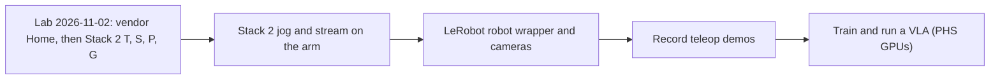

# Project status

**As of 2026-11-01, branch `stack2` (PRs #62 and #63 merged).** One page: what works, how well we know it, what is in the way. Old reports: `reports/INDEX.md (in git history)`. Update this page whenever a result changes a row.

**Goal:** our own Python code (Stack 2, no vendor DLL) drives the Intelitek ScorBot ER-4U through its original controller, so LeRobot can record demos and run VLA policies on it as a teaching tool. Decided 2026-10-31.

**In one paragraph:** there are two stacks (map: root `CONTRIBUTING.md`, "Layers"). **Stack 1** drives Intelitek's own `USBC.dll` from Python (`tools/usbc_*`); its vendor Home ran on the real arm on 2026-10-20 (Home OK in 134 s, order 2, 3, 5, 4, 1, 6; log in the private repo). The arm server and Python API (`tools/usbc_server`, `scorbot/bridge.py`) are built on Stack 1 and ran end to end on the lab DLL against a fake controller, but not yet on the arm. **Stack 2** is our own USB protocol (`scorbot.Scorbot`, `openScorbot`) and the main path: its vendor-Home port now sends the lab DLL's commands in the DLL's order on a fake controller, and its whole bring-up passes there, but its one real home attempt (2026-10-06, the older legacy home) failed after 4.2 s. Next try: the 2026-11-02 lab visit. Stack 1 is the backup.

## Evidence scale

| Level | Meaning |
|---|---|
| E0 | Idea or note, no design |
| E1 | Designed: a spec or doc exists, no code |
| E2 | Built, with unit tests, no hardware and no outside reference |
| E3 | Checked against an outside reference without the arm (vendor DLL on a fake controller, the ULPGC thesis capture, vendor disassembly) |
| E4 | Ran on the real arm once, result recorded in a log |
| E5 | Ran on the real arm repeatedly and the behaviour is understood |

"Reviewed" is a separate column: yes means two independent reviews found nothing open; it never raises the level. A simulator run is E2, never more.

## Stack 1: vendor DLL (the backup, and the only path that has moved the arm)

| Capability | Level | Reviewed | Proof | What is in the way |
|---|---|---|---|---|
| Vendor Home (`tools/usbc_home`) | E4 | no | 2026-10-20 run log, private repo; lab Par files match `protocol/VENDOR_HOMING_TRACE.md` | Ran once |
| Arm server + Python API (`tools/usbc_server`, `scorbot/bridge.py`) | E3 | no | `tests_extra/test_usbc_server.py`; desk run on the lab DLL build against `tools/usbc_fake`, 2026-10-20 ([`requirements/arm-api.md`](requirements/arm-api.md)) | First lab run; independent review before merge |
| Relative point move (`move_by`, `tools/usbc_move`) | E3 | no | Desk run above (a 10 mm move read back as 9,996 units) | Physical mm scale unmeasured (`examples/arm_characterise.py`) |
| Absolute move (`move_to`) inside the measured box | E3 | no | Desk run above | Absolute Teach never ran on the arm |
| Gripper, speed (`OpenGripper`, `CloseGripper`, `Speed`) | E3 | no | Desk run above; names from the lab DLL's export table | Never ran on the arm |
| Joint jog (`tools/usbc_jog`) | E2 | no (one review) | `tests_extra/` | Axis numbers not confirmed on the arm |
| Characterise, pick-and-place (`examples/`) | E2 | no | `tests_extra/test_arm_api.py` | Needs the arm and a printed mm grid mat |

## Stack 2: own USB protocol (the main path)

| Capability | Level | Reviewed | Proof | What is in the way |
|---|---|---|---|---|
| Connect, handshake, raw state read | E4 | no | `evidence/2026-09-29-idle-capture-handoff.md (in git history)` | Only one idle capture |
| Legacy home | E4 (failed) | no | `evidence/2026-10-06-lab-logs/ANALYSIS.md (in git history)` | Failed at 4.2 s |
| Vendor-home port (`scorbot/vendor_home.py`) | E3 | no (gripper end changed 2026-10-31; 3 review rounds, the last still open on ledger PL29) | `tests/fixtures/vendor_home_trace05.json` (lab DLL on the fake, command for command), the full Stack 2 bring-up on the pipe fake, [`protocol/LEDGER.md`](protocol/LEDGER.md) | Lab visit 2026-11-02: steps T, S, P, X and G in `lab/LAB_CHECKLIST.md` (`scripts/lab_day.py` runs them) |
| Packet codec (`scorbot/transport/`) | E3 | no | `tests/test_transport_codec.py` | Not wired into `Scorbot` |
| Joint jog, streaming, gripper, inch home, software stop | E2 | no | `tests/`, `tests_extra/` | Never ran on the arm |
| Simulator, recording, replay (`scorbot/session/`) | E2 | no | `tests/` | Offline only |
| LeRobot plugin (`plugins/lerobot_robot_scorbot`) | E2 | no | `examples/lerobot_sim_check.py` against lerobot 0.6.1 in its own venv (2026-11-01: `lerobot-record`, reload, replay), `tests_extra/test_lerobot_scorbot_plugin.py` | Simulator only, real arm refused; no gripper yet |

## Critical path

Steps and pass lines: [`lab/LAB_CHECKLIST.md`](lab/LAB_CHECKLIST.md) section 3b. What is reversed and what is still open: [`protocol/LEDGER.md`](protocol/LEDGER.md). Stack 1 steps stay in [`lab/RUN_THE_ARM.md`](lab/RUN_THE_ARM.md).

## Owner decisions open

| Decision | Needed before |
|---|---|
| Driver for the visit: Intelitek's (`--transport auto`) or WinUSB via Zadig (`pyusb`, swap back before leaving) | The 2026-11-02 visit |
| Installing `lerobot` (new dependency) | The LeRobot wrapper (done in a separate venv for the simulator check; the repo itself still does not depend on it) |
| Near-home confirmation, shoulder travel bound, BACKLOG 20 (`project/BACKLOG.md (in git history)`) | Stack 2 streaming on the arm |

## Not covered here

The story of each change is in `project/PROJECT_LOG.md (in git history)`; hazards are in `design/SAFETY_CASE.md (in git history)`.
