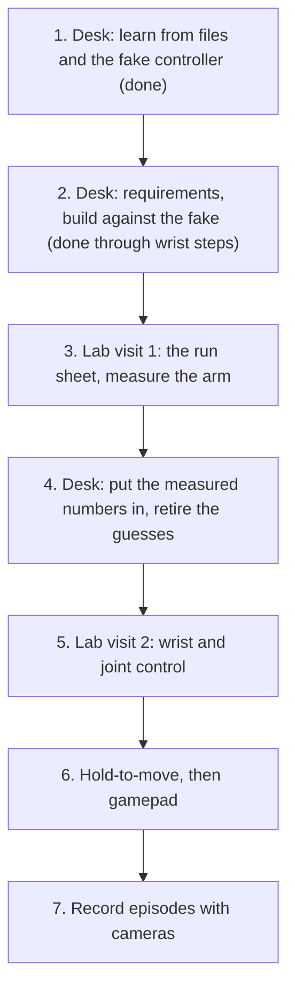

# Status and roadmap

Purpose: what works, how sure we are, what is unknown, and the order of the work ahead.

As of 2026-10-26, `main`. Update this page whenever a result changes a row.

**Goal:** drive all of the ScorBot ER-4U from a PC, safely: the tool position (x, y, z), the wrist pitch and roll, each joint on its own and the gripper. Control it from Python, from the keyboard and later by holding a key. Then record what the arm does so a robot can learn from it.

**Where it stands:** the arm moves through Intelitek's own `USBC.dll`. The vendor Home ran on the real arm on 2026-10-20 (Home OK in 134 s, joint order 2, 3, 5, 4, 1, 6). The arm server, the Python API, the episode recorder, keyboard control and wrist steps have run against the lab DLL on a fake controller or in unit tests, but not on the arm. What the DLL itself says about axes, directions and wrist units is in [DESK_FINDINGS.md](DESK_FINDINGS.md). Our own USB protocol (no DLL) is on the `stack2` branch.

## Evidence scale

| Level | Meaning |
|---|---|
| E0 | Idea or note, no design |
| E1 | Designed: a spec or doc exists, no code |
| E2 | Built, with unit tests; no hardware and no outside reference |
| E3 | Checked against an outside reference without the arm (vendor DLL on a fake controller, a recorded capture, vendor disassembly) |
| E4 | Ran on the real arm once, result recorded in a log |
| E5 | Ran on the real arm repeatedly and the behaviour is understood |

A simulator run is E2, never more.

## Capabilities

| Capability | Level | Proof | What is in the way |
|---|---|---|---|
| Vendor Home (`tools/usbc_home`) | E4 | 2026-10-20 run log; the lab parameter files match the vendor homing trace | Ran once |
| Arm server and Python API (`tools/usbc_server`, `scorbot/bridge.py`) | E3 | `tests/test_usbc_server.py`; desk runs on the lab DLL against `tools/usbc_fake`, 2026-10-20 and 2026-10-25 ([requirements](requirements/arm-api.md), [DESK_FINDINGS.md](DESK_FINDINGS.md)) | First lab run |
| Relative move (`move_by`, `tools/usbc_move`) | E3 | Desk run above: a 10 mm move read back as 9,996 units | Physical mm scale not measured (`examples/arm_characterise.py`) |
| Absolute move (`move_to`) inside the measured box | E3 | Desk run above | Absolute Teach never ran on the arm |
| Gripper and speed | E3 | Desk run above; call names from the lab DLL's export table | Never ran on the arm |
| Joint jog (`tools/usbc_jog`) | E2 | `tests/test_usbc_jog.py` | Axis numbers not confirmed on the arm |
| Characterise and pick-and-place (`examples/`) | E2 | `tests/test_arm_api.py` | Need the arm and a printed mm grid mat |
| Keyboard control (`examples/teleop.py`) and wrist steps (`wrist_by`) | E2 | `tests/test_teleop.py`, `tests/test_usbc_server.py`; desk run of the DLL on the fake controller | Never ran on the arm; wrist unit (probably 0.001 degree) unverified |
| Run log and summary (`scripts/summarize_log.py`, status line in `teleop.py`) | E2 | `tests/test_usbc_server.py`, `tests/test_summarize_log.py`, `tests/test_teleop.py`; [requirements](requirements/run-log.md) | Never ran on the arm; reports what was asked and answered, not whether the arm moved |
| A second client gets a `busy` line instead of waiting | E2 | `tests/test_usbc_server.py`, `tests/test_arm_api.py`; [requirements](requirements/lab-prep-polish.md) | Never ran on the arm; the server only looks between commands, so a client that connects during a move waits until it ends |
| Ctrl+C during a move sends `stop` | E2 | `tests/test_arm_api.py`; a real `CTRL_C_EVENT` run on Windows against a stand-in server | Not yet seen while `teleop.py` waits for a key; never ran on the arm |
| Episode recorder (`examples/record_episode.py`) | E2 | `tests/test_record_episode.py`; `--fake` rehearsal | Never ran with real cameras or the arm |
| Lab preflight (`scripts/lab_check.py`) | E2 | `tests/test_lab_check.py` | The USB, driver and 32-bit Python checks never ran on the lab PC |
| LeRobot adapter (`plugins/`) | E2 | `tests/test_lerobot_stack1.py`; [requirements](requirements/stack1-lerobot-adapter.md) | Never ran on the arm or against an installed `lerobot` |

## What we do not know yet

| Unknown | Blocks | How we find out |
|---|---|---|
| Which DLL axis number is which joint, and which direction is plus | Joint jog | Desk: ask the DLL through the fake controller (done, [DESK_FINDINGS.md](DESK_FINDINGS.md)). Confirm at the lab |
| How far one pitch or roll unit turns the wrist | Wrist keys | Same |
| Whether `move_by` keeps the wrist still | Wrist keys | Lab |
| The working box and the mm scale | `move_to`, wrist keys | `examples/arm_characterise.py` at the lab |
| Real speed (commands per second) | Hold-to-move | `examples/arm_latency.py` at the lab |
| How far the arm coasts after a stop | Hold-to-move | Lab, slow and short |
| How the controller reacts if USB drops | Hold-to-move safety | Last, a careful bench test |

The vendor's parameter files already give per-axis limits, jog directions and link lengths (read-only, local, never committed). They are priors, not measurements.

## Roadmap

**Next:** step 3. Follow [lab/LAB_RUN_SHEET.md](lab/LAB_RUN_SHEET.md); steps and commands are in [lab/RUN_THE_ARM.md](lab/RUN_THE_ARM.md). Record every number on this page: a step that ran on the arm moves up to E4.

1. **Learn at the desk.** Ask the vendor DLL what it sends the controller for each move: axis order, directions, counts per mm and per degree, how pitch and roll map to the two wrist motors.
2. **Requirements, then build.** A numbered list with a check on every line, then wrist keys, joint jog and hold-to-move against the fake DLL. Unknown numbers live in one settings spot with tiny, slow defaults. Tests cover what can hurt the arm: step caps, stop on release, cleanup after an error or Ctrl+C, refusals outside the box.
3. **Lab visit 1.** Preflight, Home, `where`, one small move, gripper, latency, characterise, teach four points, pick and place.
4. **Fold the numbers in.** Replace each guess with a measured value. A claim moves up an evidence level only when a log backs it.
5. **Lab visit 2.** Try the wrist keys and joint jog at tiny steps and 5 percent speed, then check the signs and units against the desk table.
6. **Hold-to-move.** Short capped bursts sent while a key is held, stopping when presses stop. Needs the latency and coast numbers. Gamepad later.
7. **Record episodes.** Cameras, arm state and commands, for learning. The recorder exists; it has not run with real cameras.

## Open items

| Item | Needed before |
|---|---|
| Lab date | Planning |
| A 10-second desk check that Ctrl+C ends `teleop.py --fake` while it waits for a key | Lab |
| On the arm: joint directions, the wrist unit, latency, coasting after a stop | Joint jog and hold-to-move |

## Rule that does not change

A claim about the arm that no bench log backs is written "unverified".
