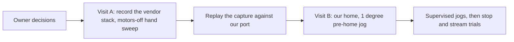

# Project status

**As of 2026-10-13, `origin/main` at `a8e4d86`.** One page: what works, how well we know it, what is in the way. Detail lives in the linked docs and in [`reports/INDEX.md`](reports/INDEX.md). Update this page whenever a report changes a row.

**Goal:** supervised Python control of the Intelitek ScorBot ER-4U through its original controller: connect, home, small joint jogs, and later streamed motion for research. Requirements: [`../REQUIREMENTS.md`](../REQUIREMENTS.md) (draft until the owner baselines it).

**In one paragraph:** the software is far ahead of the evidence. Connecting and reading idle state worked on the real arm once (2026-09-29). The one real-arm homing attempt (2026-10-06, legacy code) failed after 4.2 s with `error code 1`. Everything since is built and tested without the arm, checked against the vendor's own `USBC.dll` running on a fake controller, and reviewed by Codex and Gemini. **Nothing built by us has yet moved the arm.** The next step is a lab visit.

## Evidence scale

| Level | Meaning |
|---|---|
| E0 | Idea or note, no design |
| E1 | Designed: a spec or doc exists, no code |
| E2 | Built, with unit tests, no hardware and no outside reference |
| E3 | Checked against an outside reference without the arm (vendor DLL on a fake controller, the ULPGC thesis capture, vendor disassembly) |
| E4 | Ran on the real arm once, result recorded in a log |
| E5 | Ran on the real arm repeatedly and the behaviour is understood |

"Reviewed" is a separate column: yes means Codex and Gemini both reviewed it and the findings were fixed; it never raises the level. A simulator run is E2, never more.

## Capabilities

| Capability | Level | Reviewed | Proof | What is in the way |
|---|---|---|---|---|
| Connect, handshake, raw state read | E4 | no | [`evidence/2026-09-29-idle-capture-handoff.md`](evidence/2026-09-29-idle-capture-handoff.md) | Only one idle capture; the motor-disable-after-handshake transition is unmeasured |
| Packet codec (`scorbot/transport/`) | E3 | no | Golden tests are byte-identical to the legacy code (`tests/test_transport_codec.py`) | Not wired into `Scorbot` |
| Legacy home | E4 (failed) | no | [`evidence/2026-10-06-lab-logs/ANALYSIS.md`](evidence/2026-10-06-lab-logs/ANALYSIS.md) | Failed at 4.2 s; BACKLOG 1, 1b, 2, 3 |
| Vendor-home port (`scorbot/vendor_home.py`) | E3 | yes (4 rounds) | [`specs/2026-10-08-vendor-home-port.md`](specs/2026-10-08-vendor-home-port.md), `tests/test_thesis_crosscheck.py`, `tests/test_vendor_home_geometry.py` | Visit A capture; wrist roll switch must stay on for about 750 counts or more; BACKLOG 1c |
| Vendor DLL on a fake controller (`tools/usbc_fake/`) | E3 | yes | `tools/usbc_fake/` | A fake has no stop and no collision flag, so it says nothing about the real arm |
| Inch home (`home_inch`) | E2 | no | `tests/test_inch_home.py` | Never run on the arm; BACKLOG 1a |
| Joint jog, base, shoulder, elbow (at most 5 degrees) | E2 | no | `tests/test_arm_control.py` | Directions and scale are inherited, not measured (HZ-02, BACKLOG 8) |
| Wrist jog | blocked | n/a | Refused in `jog_joint` by design | Two-motor coupling unmeasured (HZ-14) |
| Software stop (`request_stop`) | E2 | no | `tests/test_software_stop.py` | Sequence is from disassembly; lab plan step F3. Not an emergency stop |
| Streaming (`start_stream`) | E2 | no | `tests_extra/` | First trial `examples/bench_stream.py`; trace-size limit past 45 s |
| Gripper (`move_gripper`) | E2 | no | `tests_extra/test_gripper.py` | Never run; one known flaky test (BACKLOG, code-health note) |
| Measured calibration | E1 | no | `scorbot/calibration.py`, `scripts/fit_calibration.py` | No physical angle data yet |
| Source-model joint limits | E2 | no | `tests/test_source_model.py` | The only travel bound since the cap went to 180 degrees (HZ-25); unmeasured |
| Recording, replay, analysis (`scorbot/session/`) | E2 | no | `tests/` | None; offline |
| Simulator (`SimulatedScorbot`) | E2 | no | `tests/test_simulated.py` | Models no hard stops or coupling |
| Camera capture | E2 | no | `tests_extra/` | None for the first visit |
| Cartesian motion | out of scope | n/a | Removed 2026-10-08 | Kinematics are unverified |

Test counts and pass state are in each report's Verification section, not here: this page is not re-run on every edit.

## Critical path

1. **Pick a lab date.** Visit A needs the owner, the arm, USBPcap and a phone level. Follow [`lab/VISIT_A_AGENT_CHECKLIST.md`](lab/VISIT_A_AGENT_CHECKLIST.md). Nothing in this list moves without it.
2. **Visit A result to read first:** the hand sweep's wrist roll switch width. If it is narrower than about 750 counts, tell the owner before the vendor home runs.
3. **Replay:** `scripts/replay_vendor_home.py` on the capture, then fix what differs.
4. **Visit B:** our own port, starting with a 1 degree pre-home jog, hand on the physical stop.

## Owner decisions open

| Decision | Where | Needed before |
|---|---|---|
| A typed "near home" confirmation in the vendor-home gate | BACKLOG 1c (b) | Visit B |
| The shoulder travel bound (30,000 counts is about 264 degrees against a 165 degree span) | BACKLOG 1c (e) | Visit B |
| Whether `enabled` becomes unknown after a calibration fault | BACKLOG 20 | After visit A |
| Baseline `REQUIREMENTS.md` | [`../REQUIREMENTS.md`](../REQUIREMENTS.md) | Any further build work |

Optional lead, not started: ask the ULPGC thesis tutor for `codigo.7z`, which has the capture folder.

## Not covered here

Per-bug detail is in [`project/BACKLOG.md`](project/BACKLOG.md), the story of each change is in [`project/PROJECT_LOG.md`](project/PROJECT_LOG.md), and hazards are in [`design/SAFETY_CASE.md`](design/SAFETY_CASE.md).
