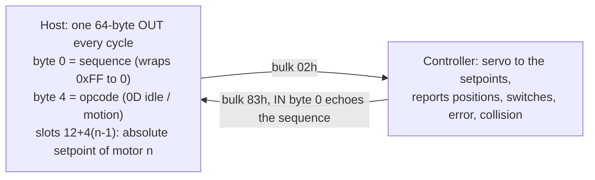

# What the ULPGC thesis tells us (read 2026-10-08)

Source: Yeray Miranda Betancor, *Estudio y análisis de las comunicaciones en el robot Scorbot-ER 4u. Desarrollo de un driver e implementación para su uso en interfaz web*, final-year project, Universidad de Las Palmas de Gran Canaria, March 2017 (tutor Pedro Medina Rodríguez). Handle: <https://accedacris.ulpgc.es/handle/10553/25527>. The PDF is kept locally in `references/` (git-ignored, never commit it). Page numbers below are the thesis's own printed page numbers. Labels: **V** = shown in the thesis's captures or code, **I** = our inference, **N** = not in the thesis.

## Why this source matters

- **Same hardware.** Its device dump is `09F1/0007` with two bulk endpoints, `83h` in and `02h` out, 64-byte packets (p. 105). That is our controller.
- **It is the only public decode made from real SCORBASE captures**, not from the vendor DLL. It is independent of our own disassembly, so where the two agree the claim is much stronger than either alone.
- **It was checked against SCORBASE's own display** (encoder values, switch states), and the author's driver then moved a real arm: waist 1500 and 10,000 counts, wrist roll and tilt, and a five-motor move of thousands of counts from a random pose (pp. 97 to 100).
- **It explains the controller's control model**, which is what the unknowns in `docs/design/SAFETY_CASE.md` section 7 are really about.
- Limits: one student, Windows XP, 2017 firmware, observation only (no disassembly, p. 102). He never describes his own home search, gives no counts per degree, and measures no timeouts.

## How the controller works (the model the thesis supports)

1. **Control is a stream, not a command (V, pp. 25 to 30).** After control-on the host must keep sending sequenced messages. Without them the controller drops control, the POWER LED goes green to orange, and a new control-on is needed.
2. **A move is a series of setpoint steps (V, pp. 28, 44 to 52).** There is no speed parameter; SCORBASE speed is the size of the step per message. Measured on the waist over 2 s: speed 1 = 1500 counts, speed 5 = 10,000, speed 10 = 15,000 (750, 5000 and 7500 counts/s).
3. **Order of a move (V, pp. 44 to 49).** One `47`, then `0D` messages that change the motor slots, then three end messages: `4F 3F 53`, `73 20 00`, `42 20 00`.
4. **Counts (V, pp. 28, 48, 50).** Each slot is a 16-bit little-endian magnitude plus two sign bytes (`00 00` positive, `FF FF` negative). A negative count is the 16-bit value minus 65535: `FF 8C` reads -115. Verified against SCORBASE's display.
5. **Zero (V, pp. 1, 54, 58).** Counters are 0 at power-on, wherever the arm is. SCORBASE homes, then resets each axis with `48`; after that counts are relative to home. Even after SCORBASE homes, an idle count can drift to 1 or -1.
6. **Home switches (V, pp. 53 to 56).** One per axis except the gripper, read in IN offset 5. Pressed = bit set. Bits in order: 0x01 base, 0x02 shoulder, 0x04 elbow, 0x08 wrist, 0x10 roll, summed when several are pressed (shoulder + elbow = 0x06). He pressed each one with a screwdriver while recording.
7. **Collision flag (V, p. 57).** IN offset 59 (0-based, as in his Figures 51 and 52) is a per-motor bitmask: 0x01 for motor 1, 0x18 for motors 4 and 5, 0x20 for the gripper. When it is set the controller stops motion and SCORBASE reports the axis. SCORBASE then resynchronises its setpoints from the positions the controller reports.
8. **The gripper is homed by driving into its stop** until that flag sets (pp. 57, 108).
9. **After Home, eight position fields read `FF FF 7F` (V, pp. 31 to 32).** That is 0x7FFFFF, our V14 zero, so it corroborates V14 (24-bit position, zero at 0x7FFFFF).
10. **Open-loop drive scale for motors without an encoder (V, p. 62).** The conveyor drive value is 0x64 at speed 5 and 0xC8 at speed 10, so about 20 per speed step. I: the vendor's `4D` homing velocities (+90 to +110, units unknown in `VENDOR_HOMING_TRACE.md`) are then about half scale.

## What this settles or changes

| Item | Status before | Now |
|---|---|---|
| Switch polarity (SAFETY_CASE Q4) | "bit set = on" from the DLL, unverified on the arm | **Confirmed by an independent physical test.** Our `HOME_SWITCH_BITS` order (base 1, shoulder 2, elbow 4, pitch 8, roll 16) matches. Caveat: pitch vs roll for bits 8 and 16 is by his pressing order only. |
| 65535 wrap convention (BACKLOG 5) | "unconfirmed by a trace" | **Confirmed** (p. 48). |
| `47` and the end sequence (V3) | from disassembly | Matches captures; `47` precedes every move. |
| `48` Set position (the packet rule) | never sent, needs a capture | A SCORBASE capture exists in a published source (pp. 59 to 60): `4F 40 54`, `48 xx 00`, then `47 00 00`, `4F 40 53`, `73 20 00`, `42 20 00`. Motor codes 12, 16, ... 40 are the slot offsets. **Still not our own capture, so the rule still blocks using it.** |
| Comms loss (Q1, HZ-16) | stated by the manual, never observed | Qualitative support: no stream means control lost and the LED goes orange. **No timeout number.** |
| Error bytes (Q7) | unknown meaning | The controller has its own **collision flag at IN offset 59** that our decoder never reads. Our DLL reading already listed byte 59 as "impact" (`VENDOR_DLL_PROTOCOL.md` section 6, from disassembly); the thesis adds **capture evidence** (Figures 51 and 52) and the per-motor bit layout. `MAX_ERROR` in `setHome.py` is a host-side check on the position-error word, not the controller's flag. |
| Home direction from power-on | open | The author says he could not tell which way an axis must turn to find its switch (p. 54). Supports searching both ways (`home_inch`). |
| Idle drift | simulator guess | Across the 10-06 sessions the shoulder read 12, then 2 at connect. The thesis reports 1 or -1 drift at idle after SCORBASE homing. Our `DRIFT_COUNTS 20` and `STABLE_COUNTS 2` bands look sensible. |

## Requirements this evidence supports

| ID | Requirement | Owner / where |
|---|---|---|
| T1 | While control is on, the sequenced message stream must never stall (logging, disk, GC, timeouts included). Record the longest gap between messages in every log. | `Scorbot` sync worker; HZ-09 |
| T2 | Treat motion as setpoint streaming: bound the step per message and the lead of setpoint over actual position. Already true for `max_jog_degrees` and the stream lead limit. | `robot.py`, `streaming.py` |
| T3 | Decode IN offset 59 as a per-motor collision bitmask. Any non-zero value stops the stream, latches a fault via `_latch_fault`, and is logged with the counts and error words. The gripper is the one place a collision is expected, and it must not be homed this way here. | `state.py` (in the motion fingerprint) |
| T4 | During any home search, log counts, error words, switch bits and the collision flag every message (or every few), not only at the end. Without them a failure teaches nothing (10-06). | `setHome.py` (fingerprint), `Scorbot.home` |
| T5 | After a stall, resynchronise every setpoint from the latest reported positions before sending anything else. Keep that rule in the jog and stream code. | `libcomm.py`, `streaming.py` |
| T6 | Counts are relative to power-on until a verified home. Never treat counts of 0 as the vendor home. If SCORBASE homed first, record whether the controller stayed powered. | session recorder, runbook |
| T7 | Before any home, run a no-motion switch check: press each microswitch by hand with the arm idle and confirm which bit moves. This gives the exact bit-to-axis map for this arm (including pitch vs roll). | lab procedure |
| T8 | Moves of several motors at once are accepted by the controller (thesis p. 99). Single-motor moves leave the other motors' counts unchanged (p. 100), but that test used the waist, not the coupled shoulder. | coupled-move design |
| T9 | Counts always use `signed_count_delta`; encode and decode with 16-bit + sign pair. | everywhere |
| T10 | A capture of SCORBASE Home plus a 1 degree waist jog is short and decodable (the thesis did it on a lab PC with a filter driver and USBTrace). Make it the first capture. | `docs/lab/USB_CAPTURE.md`, S1 addendum |

Status (2026-10-08): the recording half of T3 and T4 is built (`collision_motors`, `RobotState.collision_bits`, a `motion_trace` row for the legacy home, `scripts/home_trace_report.py`), never run on the arm. Latching a fault on the flag waits until it has been seen on the arm.

## What it changes about the 10-06 failure

See `docs/evidence/2026-10-06-lab-logs/ANALYSIS.md` ("Revised reading"). In short: polarity is now confirmed, which removes the "switch was never seen" explanation, and the 4.2 s duration fits the legacy search lagging the shoulder, not a start next to the upper stop.

## What it does not answer

- Jog direction in degrees and counts per degree (his degree conversions are in the CD code, not the thesis).
- Software stop, comms-loss timing, e-stop packets.
- The vendor homing speeds' units and the `4D` / Mode `H` bytes.
- Whether the controller keeps its counters when SCORBASE closes.

## Experiments the thesis's method suggests (no arm motion first)

1. **Press-the-switches recording** (T7): idle recorder running, motors off, a screwdriver on each microswitch in turn. Safe, about 15 minutes.
2. **SCORBASE capture** (T10): Home, then one waist jog. Needs the capture setup already described in `docs/lab/S1_CAPTURE_ADDENDUM.md`.
3. **Repeat the legacy shoulder search only with the new T4 logging**, hand at the stop, from a pose near home (never from folded down), to see error words over time.
